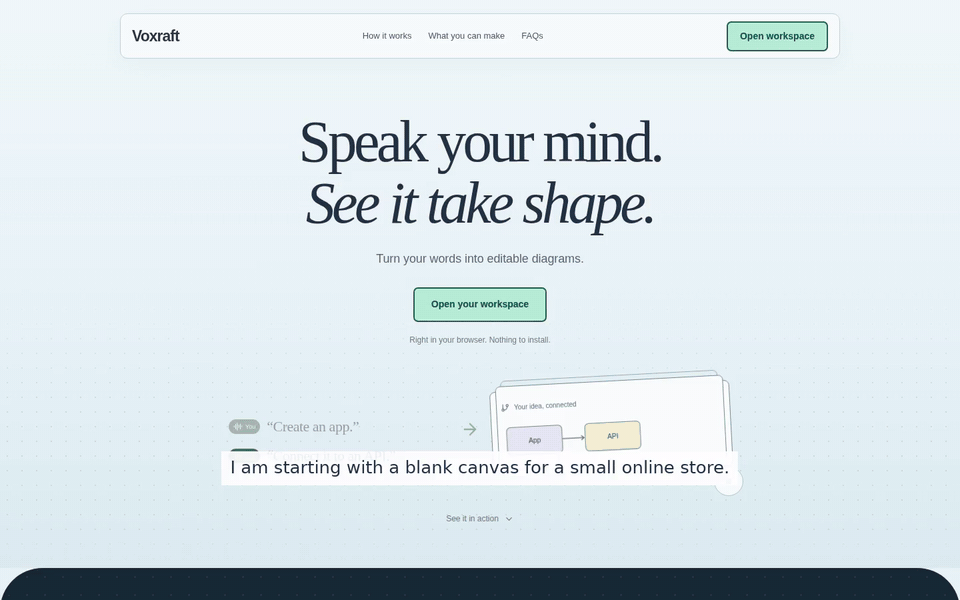
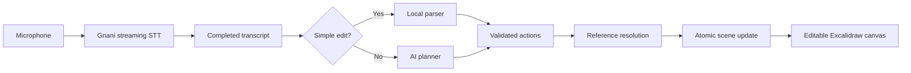

<div align="center">

# Voxraft

### Speak an idea. Shape the diagram. Keep editing.

Voice-controlled diagrams on an editable Excalidraw canvas.

[](https://react.dev/)
[](https://www.typescriptlang.org/)
[](https://fastapi.tiangolo.com/)
[](https://excalidraw.com/)

[Watch the 59-second demo](output/video/voxraft-demo-under-one-minute.mp4) · [Evaluation](docs/evaluation-2026-11-15.md) · [Deploy](docs/deployment.md)

</div>

## Demo

[](output/video/voxraft-demo-under-one-minute.mp4)

**[Play the demo with sound](output/video/voxraft-demo-under-one-minute.mp4)** (59 seconds) · [Read the timed script](output/video/under-one-minute-script.md)

The demo uses a prerecorded voice command recording replayed through a virtual microphone, with AI narration. The on-screen diagram edits were captured from the working app.

## What is Voxraft?

Voxraft turns speech or text into safe, incremental diagram edits. Create components, connect them, move or rename blocks, correct the last instruction, and undo—all while keeping the result directly editable.

It supports **Architecture**, **Flowchart**, **Mind map**, **Hierarchy**, **Brainstorming**, and mixed canvases where several diagram styles coexist.

| You do this | Voxraft handles this |
| --- | --- |
| Speak naturally | Gnani Prisma streams the transcript to the app |
| Refer to existing blocks | Stable IDs and scene context resolve the intended target |
| Give a complex instruction | An AI planner proposes validated diagram actions |
| Give a simple instruction | A local parser applies it without model latency |
| Say something ambiguous | The editor asks a follow-up instead of guessing |
| Draw or move something manually | The canonical scene stays synchronized |

## Try it by voice

Start a voice session, wait for **Listening**, then speak one instruction at a time.

| Goal | Say |
| --- | --- |
| Build a system | “Create a frontend, API gateway, authentication service, and PostgreSQL database.” |
| Connect components | “Connect the frontend to the API gateway and the API gateway to authentication.” |
| Edit spatially | “Move the database below the authentication service.” |
| Correct yourself | “No, put it above the authentication service instead.” |
| Work with history | “Undo.” or “Go back.” |
| Improve the result | “Review this diagram.” · “Make this easier to read.” · “Style this diagram.” |

Short, explicit edits on Architecture and Mixed canvases use the local parser. More complex requests use the configured planner. Command Activity shows speech, recognition, planning, scene, and view timing.

## The canvas understands structure

| Diagram type | Default behavior |
| --- | --- |
| Architecture | Components, databases, directed dependencies, review insights |
| Flowchart | Start/end ellipses, process blocks, decisions, labeled branches, loops |
| Mind map | Central topic, branches, reparenting, arrowless relationships |
| Hierarchy | Parent-child edges and top-down layout |
| Brainstorming | Independent notes and optional associations |
| Mixed | Multiple typed regions and containers on one canvas |

Voxraft preserves manual positions and styles unless a command explicitly changes them. Diagram conversion opens a preview before applying shape, relationship, or layout changes.

## How a command becomes a diagram



The browser sends 16 kHz mono PCM to FastAPI over WebSocket. Only completed transcript segments enter the serial command queue. Proposed actions are schema-validated, resolved against the current scene, and committed as one undoable edit.

## Quick start

### Requirements

- Node.js 20+
- Python 3.11+
- [`uv`](https://docs.astral.sh/uv/) for Python dependencies
- FFmpeg for REST transcription fallback

### Frontend

```bash
npm install
npm run dev
```

### Backend

In a second terminal:

```bash
cd backend
uv sync
test -f .env || cp .env.example .env
uv run uvicorn main:app --reload --env-file .env
```

Open <http://localhost:5173>. Microphone access requires localhost or HTTPS.

Text commands and starter templates work without provider credentials. Add `GNANI_API_KEY` for speech and `OPENAI_API_KEY` for complex planning, generation, and agent-assisted suggestions.

## Configuration

Copy [`backend/.env.example`](backend/.env.example) to `backend/.env`.

| Variable | Purpose | Required |
| --- | --- | --- |
| `GNANI_API_KEY` | Streaming and REST speech recognition | For voice |
| `GNANI_LANGUAGE` | Recognition locale; defaults to `en-IN` | No |
| `OPENAI_API_KEY` | Complex planning and diagram generation | For AI features |
| `AUTH_SECRET_KEY` | Signs account sessions; minimum 32 characters | Production |
| `DATABASE_URL` | PostgreSQL connection; SQLite is used when absent | Production |
| `DATABASE_URL_UNPOOLED` | Direct PostgreSQL connection for schema setup | Recommended |
| `VOICE_ALLOWED_ORIGINS` | Additional allowed HTTPS voice origins | Custom domains |

AgentRouter and generic OpenAI-compatible endpoints are also supported; see the example environment file for their variables.

## Product capabilities

<details>
<summary><strong>Voice sessions and recovery</strong></summary>

- Realtime streaming uses Gnani Prisma through a backend relay, keeping credentials off the client.
- Segment IDs suppress duplicate execution, and a serial queue preserves command order.
- Incomplete fragments such as “Move the” wait briefly for their continuation instead of executing early.
- Repeated streaming failures switch the session to browser VAD and REST transcription.
- Spoken clarification questions can be interrupted by speaking the answer.

</details>

<details>
<summary><strong>Editing and reference resolution</strong></summary>

- Select one or more blocks and refer to “this,” “these,” or spatial descriptions.
- Rename, recolor, reshape, move, connect, disconnect, reverse, or label diagram elements.
- Ambiguous names retain candidate IDs and request clarification.
- Corrections replace the most recent unchanged edit as one history step.
- Undo and redo restore full scene snapshots.

</details>

<details>
<summary><strong>Containers, scopes, and diagram conversion</strong></summary>

- Visible containers can move, nest, collapse, expand, and keep their own diagram type.
- A block uses the nearest container’s diagram rules.
- Cross-type connections require an explicit relationship.
- Architecture, Flowchart, Mind map, Hierarchy, Brainstorming, and Mixed conversions are previewed before applying.

</details>

<details>
<summary><strong>Review, layout, and visual design</strong></summary>

- **Review** finds structural issues tied to real blocks and connections.
- **Critique** compares measured layout candidates before moving anything.
- **Design** previews role-aware colors, fonts, and meaningful shape suggestions.
- Every proposal can be applied or discarded; stale proposals cannot modify a changed scene.

</details>

<details>
<summary><strong>Accounts, persistence, sharing, and export</strong></summary>

- Private diagrams autosave to the account with a browser recovery copy.
- Local development uses SQLite; production can use PostgreSQL.
- Read-only share links omit private command logs and diagram decisions and can be revoked.
- Export PNG, SVG, PDF, project JSON, or editable Excalidraw JSON.

</details>

## Architecture

| Layer | Technology | Responsibility |
| --- | --- | --- |
| Editor | React, TypeScript, Excalidraw | Canvas rendering, selection, command UX, local validation |
| Scene engine | TypeScript, Zod | Stable IDs, actions, references, containers, history |
| API | FastAPI | Authentication, projects, planner endpoints, sharing, quotas |
| Speech | Gnani Prisma, FFmpeg | Realtime STT and recorded-audio fallback |
| Planner | OpenAI or compatible endpoint | Complex scene-aware commands and generation |
| Storage | SQLite or PostgreSQL | Accounts, sessions, diagrams, shares, rate limits |

For deeper implementation notes, see [agent memory and orchestration](docs/agent-memory.md), [semantic shapes](docs/semantic-shapes.md), and [deployment](docs/deployment.md).

## Quality checks

```bash
npm run typecheck
npm test
npm run build

cd backend
uv run pytest -q
```

Run the local parser latency benchmark without external provider calls:

```bash
cd backend
./.venv/bin/python benchmark_latency.py --samples 20
```

The dated [evaluation report](docs/evaluation-2026-11-15.md) records planner replay results, browser scenarios, real microphone timings, security checks, and measurement limits.

## Project status

Voxraft is a personal project under active development. The current voice experience is English-first, complex edits depend on a configured planner, and collaborative real-time editing is not implemented yet.

Pushes and pull requests run frontend and backend checks and verify the production container build. No production host is currently configured.
