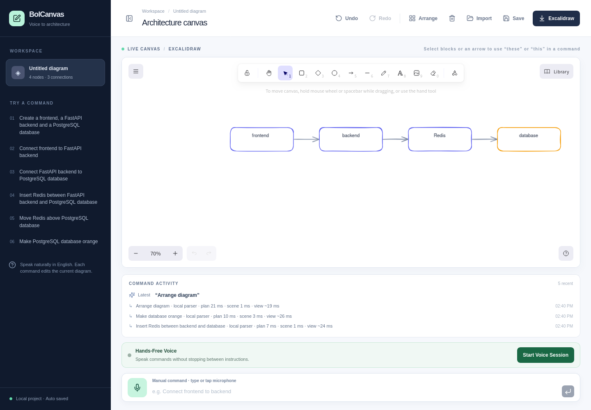

# Voxraft

Voxraft opens on a public home page. Create an account at **Sign up** with an email and a password of at least 12 characters. Sign-in opens a dashboard of your private diagrams. Choose **New canvas** on the dashboard and press **Start speaking** in the editor. Say “Create a diagram showing how a refund moves from request to resolution”; the AI chooses the type. **Add by voice** creates another typed region on the same canvas, so a flowchart, mind map, and architecture diagram can coexist. Text commands remain available in the dock. Each region keeps its own shape and connection rules. **Account** lets you change your password and sign out. Each diagram autosaves to the backend and keeps its own browser recovery copy for connection failures. Canvases with no visible shapes, connections, or containers are discarded when the dashboard loads; diagrams with content stay saved. An older local draft can be imported as a separate diagram after signing in. Local development uses SQLite; set `DATABASE_URL` to use PostgreSQL for a deployed app. Set a stable `AUTH_SECRET_KEY` of at least 32 characters in production.

The **Diagram decisions** section holds up to eight short notes that you explicitly save. You can also say **“Remember that PostgreSQL database already has failover outside this diagram”** or **“Forget that PostgreSQL database already has failover outside this diagram.”** Notes are saved with the scene, included in undo/redo and project exports, and passed to the planner and review agents as context. A named failover decision suppresses that database's repeated replica hint; a vague note such as “managed externally” does not. **Clear** retains decisions; **New diagram** creates a separate blank project.

Voxraft also supports Flowchart diagrams. Describe a checkout process in the editor, or say **“Generate a flowchart for checkout.”** New steps use process rectangles, a question such as **“Payment approved?”** uses a decision diamond, and **Start** and **End** use ellipses. Sequence connections have arrowheads and can loop. **“If payment succeeds, send receipt; otherwise retry”** creates a decision with labeled Yes and No paths. Review checks missing entry and exit steps, unreachable steps, and unlabeled decision paths; Critique previews a top-down flow layout.

To change an established diagram, say **“Convert to hierarchy”** or **“Convert to flowchart.”** Voxraft previews shape, relationship, and position changes. When an existing connection has no safe new meaning, choose its meaning in the preview; a mind map may also need a central topic. **Apply conversion** commits one undoable edit, while **Discard conversion** leaves the canvas as it was. Node and edge IDs and manually chosen shapes, colors, and fonts are preserved.

Containers can have their own diagram types. The AI assigns a type to each generated region. You can also say **“Set Ideas container to Mind map”** and **“Set Ideas as the central topic of Ideas container.”** A new block uses the nearest container type: **“Add PostgreSQL inside Ideas container”** is a topic, while the same label inside an Architecture container is a database. **“Add Payments under Features”** works when Features belongs to a mind map container. Connections between different types require an explicit meaning, such as **“Relate Payments to API Gateway.”** Review, Critique, and Design evaluate each scope using its type. Container intent and roots are saved and undoable.

Voxraft supports Architecture, Mind map, Hierarchy, Brainstorming and notes, and Flowchart diagrams. A new canvas starts without a canvas-wide type: “Add PostgreSQL” creates a neutral rectangle, and “Add PostgreSQL as an idea” records an explicit note role. “Relate A to B,” “Make A the parent of B,” and “Connect A to B as a sequence” establish different relationship meanings without choosing a diagram type. The AI infers a type when a command gives enough evidence; it asks for relationship details when the meaning is ambiguous. The AI selects a type when generating each diagram. You can also say “Generate a diagram about checkout” or request a specific form. Region types and editable purpose are saved with project history. Existing shapes and connections stay as drawn when a type is chosen; defaults guide new elements. In a mind map, “Add Payments under Features” makes a branch without an arrowhead; “Move Payments under Checkout” reparents it. In Hierarchy, “Add Platform under Engineering” creates a parent–child edge, and “Put Platform under API Team” changes ancestry without moving existing nodes. **Review** identifies unattached hierarchy nodes; **Critique** previews a top-down tree before you apply it. In Brainstorming, new nodes are rectangular notes regardless of labels such as PostgreSQL. Use “Group Checkout ideas and Demo video as submission ideas” for loose membership; links appear only when requested, as arrowless associations by default. Critique preserves nonoverlapping note positions. **New diagram** starts a separate blank project; **Add by voice** keeps the current canvas and adds another typed region.

Voice controlled diagram editing. React + Vite renders an editable Excalidraw canvas. A separate canonical scene stores nodes, edges, relationships, diagram intent, recent references, and undo/redo snapshots.

On an empty canvas, describe an idea in **Generate** and choose Flowchart, Mind map, Org chart, System architecture, or Brainstorming. With an AI planner configured, Voxraft builds a connected, editable diagram in one undoable step. Spoken commands such as **“Generate a flowchart of order fulfillment”** use the same path. Four starter templates work without AI. The **More** menu exports PNG and SVG, opens the browser print dialog for PDF, and still exports editable Excalidraw JSON. Images placed on the canvas are saved with the project and restored on reload; a project is limited to 3 MB, including embedded images. **Share read-only link** publishes the latest saved canvas at a secret URL. The shared view refreshes every 15 seconds, and **Stop sharing** revokes the link. Command logs and private diagram decisions are excluded from the shared response.

Built for developers and students who want to explain a system out loud while building its diagram. Gnani Prisma handles speech recognition; validated actions keep the canvas editable across successive instructions.

- [One-page solution pitch (PDF)](output/pdf/bolcanvas-solution-pitch.pdf) · [Text version](docs/solution-pitch.md)
- [Hackathon submission text, 2–3 minute demo script, and interview preparation](docs/submission.md)
- [Measured evaluation report](docs/evaluation-2026-11-11.md)
- [Agent memory and orchestration design](docs/agent-memory.md)
- [Render deployment and production checks](docs/deployment.md)



## Run

```bash
npm install
npm run dev
```

In another terminal, start the local SQLite backend:

```bash
cd backend
uv sync
test -f .env || cp .env.example .env
uv run uvicorn main:app --reload --env-file .env
```

To use the linked Neon `production` branch instead, keep the Neon-generated `.env.local` in the repository root and run `npm run dev:api:neon` from that root. This loads the existing `backend/.env` settings and the Neon `DATABASE_URL` and `DATABASE_URL_UNPOOLED` without copying credentials. Run `npm run dev` in the other terminal. The app uses the pooled URL for requests and the direct URL for schema initialization.

Open http://localhost:5173 on the computer running Vite. Microphone capture requires localhost or HTTPS; the HTTP LAN address shown by Vite does not expose the browser microphone API. Text commands work without credentials. For voice use, install FFmpeg and set `GNANI_API_KEY` in the backend environment. Copy `backend/.env.example` to configure Gnani and the OpenAI diagram planner. Set `OPENAI_API_KEY`; the default planner model is `gpt-4o-mini` and can be changed with `OPENAI_MODEL`. The local parser handles basic commands when no planner is configured. If a configured planner fails, Voxraft reports the failure instead of applying a potentially different local interpretation.

Click **Start voice** once and wait for **Listening** before speaking; audio is not sent while the status says **Connecting**. Interim recognized words appear in the voice status, but only completed utterances change the diagram. Gnani's realtime VAD marks completed utterances. Voxraft applies each completed command in order while the microphone remains active. **Stop voice** closes the WebSocket, cancels pending edits, and releases the microphone. If realtime streaming disconnects repeatedly, the continuous session switches to browser VAD segmentation and the existing Gnani REST transcription endpoint automatically. REST fallback uses about 1.1 seconds of silence as the utterance boundary; brief pauses stay inside one instruction. With Prisma v3, both voice paths default to automatic detection across Gnani's supported English and Indian languages; this is not unrestricted language support. `GNANI_LANGUAGE_CODE` can pin a locale. `GNANI_MOCK_TRANSCRIPT` applies only to REST fallback testing, not realtime streaming.

Click one node on the canvas, then say or type commands such as **“make this green”**, **“rename this to Auth Service”**, or **“connect this to the database.”** Voxraft uses the selected node's stable ID. When a reference matches several nodes, the edit stays pending and Voxraft asks which one you mean. Reply with its name or an ordinal such as **“second one”**; say **“cancel”** to discard the pending edit. These follow-up replies work in both continuous voice and text mode. If a clarification is spoken aloud, speak over it to stop the speech and give your answer.

History and preview controls also work by voice or text: **“undo”**, **“go back one step”**, **“revert the last change”**, **“redo”**, and **“do it again”**. After a Design, Critique, or Review preview appears, say **“apply design”**, **“apply layout”**, or **“apply review”**; **“discard design”** dismisses the proposal. **“Apply that suggestion”** works when only one proposal is waiting.

Canvas references are checked against the current scene. Try **“Make the rightmost database orange”**, **“Connect all services inside Backend to Main database”**, or **“Move all blocks inside Backend below Main database.”** Container scopes include nested members, even when collapsed. Service/database filters use those words in block labels; use **“blocks”** for every member. Spatial ties ask for clarification. Group moves preserve spacing, and a bulk edit is one undo step. The planner receives current geometry, styles, directed neighbors, container ancestry, and the last unchanged command; it proposes incremental actions using existing IDs.

Shapes are available through commands such as **“Create an ellipse called Start”**, **“Make Payment approved a diamond”**, and **“Make PostgreSQL database a cylinder.”** The cylinder is a grouped Excalidraw drawing backed by one editable scene node. Labels fit each shape; arrows meet their outlines on the canvas and in previews. Shape changes keep node IDs, connections, membership, and undo history. Say **“Suggest meaningful shapes”** to review shape changes with reasons, then **“Apply shapes”** or **“Discard shapes.”** This changes only shapes. Ordinary **“Style this diagram”** requests preserve user-chosen shapes. **“Reconsider my shape choices”** permits a new shape proposal to revise them. Current suggestions cover explicit decisions, workflow start/end labels, and named databases; actors, queues, and clouds are planned later.

Shift-click to select multiple blocks, then say **“move these below the gateway”** or **“make these services blue.”** A group command such as **“group Auth and Orders as backend services”** saves membership; later commands can target **“backend services.”** Select an arrow to say **“label this connection HTTPS”** or **“reverse that arrow.”** You can also say **“disconnect Auth from Database.”** Edge labels appear on the canvas and stay in saved projects. To correct the last applied command, say **“Wait, no, connect Auth to PostgreSQL”** or **“I meant the backup database.”** The planner replans against the scene before that command, replacing its result as one undoable edit. Corrections require a configured AI planner.

Once a region exists, valid commands apply immediately, including multi-block creation and deletion. Voxraft asks a follow-up when a reference or required relationship detail is ambiguous. In Architecture, when three components connect to one database, a **Design insight** suggests reviewing replica or failover needs; **Highlight** selects the related elements without changing the diagram. Click **Review** or say **“Review this diagram”** to run the Architecture Review Agent. With an AI planner configured, it chooses up to two read-only graph tools and returns one finding tied to real components; without one, it clearly labels the rule-based review. You can highlight the evidence or accept an **Add replica** proposal as one undoable edit. A stale proposal cannot apply after the diagram changes. Click **Critique** or say **“Make this easier to read”** to compare the current arrangement with layered and grid layouts. The Layout Critic Agent groups connected blocks, keeps isolated blocks aside, and measures overlaps, connections through other blocks, crossings, edge length, and spread. It shows a routed-arrow preview and score before you apply the positions as one undoable edit. Arrow and label styling stays neutral until you request it. Click **Design** or say **“Style this diagram”** to run the Visual Design Agent. It inspects component roles, named groups, and connection targets, then previews proposed colors and fonts. **Apply design** changes the diagram in one undoable edit; **Discard** leaves it unchanged. With a configured model, the agent chooses read-only inspection tools; without one, the proposal is labeled as diagram rules. With a configured model it chooses from measured candidates; otherwise measured rules select the best candidate. **“Arrange the diagram”** and similar phrases open the same Critique preview; the layered arrangement remains one candidate. Command Activity records approximate speech-to-transcript, planner, scene edit, and next-view timings. The realtime voice connection sends up to 40 current node and group names plus common architecture terms to Gnani as key terms when a session starts or reconnects; restart a session to include newly created names. REST transcription also sends key terms with Prisma v3.

The **dashboard** creates diagrams. Each diagram's menu can rename, delete, or download its JSON project file with the canonical scene, undo/redo history, and command activity. The editor keeps Excalidraw's canvas tools visible, with compact **Assist** and **Details** menus and a command dock. Its **More** menu contains **Clear canvas** (undoable) and **Export Excalidraw**. The editor autosaves each diagram to the account, with a browser recovery copy scoped to that diagram.

## Architecture

`/api/voice/stream` relays 16 kHz mono signed 16-bit little-endian PCM frames (1024 bytes, about 32 ms) from the browser to Gnani's realtime WebSocket using the official Python SDK. Gnani credentials stay in FastAPI. Only final transcript events enter the ordered command queue; segment IDs prevent duplicate execution. The relay reconnects after Gnani failures, and the browser reconnects if its relay connection closes. The browser waits up to 16 seconds for readiness, longer than the relay's 12-second Gnani connection deadline. For a deployed frontend, set `VOICE_ALLOWED_ORIGINS` to its origin. `POST /api/transcribe` supports automatic REST fallback; it accepts multipart `audio`, converts it to 16 kHz mono WAV with an asynchronous FFmpeg subprocess, and submits it to Gnani's `/stt/v3` endpoint. `POST /api/plan` accepts command text, nodes, edges and recent IDs. With an OpenAI key, it calls Chat Completions with a strict JSON action schema; AgentRouter and a generic OpenAI-compatible endpoint remain optional alternatives. The browser validates the returned action array with Zod, resolves references against the current scene, and commits the whole batch only if every action succeeds. Undo and redo restore snapshots. Manual Excalidraw edits synchronize into the canonical scene.

The deterministic parser covers the demo commands and basic English phrasing. Free-form or complex English commands require an LLM endpoint. The app requests clarification when node references are ambiguous; it never guesses among multiple matches.

## Visible containers

Select two or more blocks and click **Contain selected blocks** in the sidebar, or type **“Put Auth and Orders inside Backend”**. A dashed frame appears around those blocks. Drag its border to move the contained blocks together. Containers are separate from named groups: one block can belong directly to only one visible container.

Use **“Add Billing to Backend container”**, **“Remove Orders from Backend container”**, **“Move Backend container right”**, and **“Rename Backend container to Platform”** to manage it. **“Nest Backend container inside Platform container”** creates a deeper boundary; **“Create Platform container containing Backend container”** creates a new parent. **“Collapse Backend container”** hides its members and routes outside connections to the visible frame; **“Expand Backend container”** restores them. The sidebar also has Collapse/Expand buttons. **“Unnest Backend container”** removes its parent link, while **“Dissolve Backend container”** removes only that boundary; blocks and connections remain. Each command is undoable. Saved projects retain membership, nesting, collapse state, and visual styles. Layout Critic moves top-level containers as units, and Visual Design can style a boundary when its name gives a clear role. It leaves unknown boundary roles neutral.

## Demo script

1. Create a frontend, a FastAPI backend and a PostgreSQL database
2. Connect frontend to backend
3. Connect backend to database
4. Insert Redis between backend and database
5. Move Redis above database
6. Rename backend to Authentication Service
7. Undo
8. Make database orange

## Tests

```bash
npm run typecheck && npm test && npm run build
cd backend && uv run pytest -q
```

If backend tests stall at `TestClient` startup in a restricted execution sandbox, run them in a normal local terminal or with sandbox permission for local sockets. The sandbox can block AnyIO's cross-thread event-loop wakeup even without application code. This is an execution-environment limitation, not a reason to disable the tests or change the server.

Tests cover successive commands, ordering, silence, duplicate completed events, partial transcripts, brief pauses, stop cleanup, WebSocket reconnect, generation validation, image file recovery, and share revocation. A previous live relay test sent a prerecorded speech clip through the FastAPI WebSocket to Gnani Prisma v3 and received two completed English utterances. A physical microphone check of the automatic language detection setting is still needed on localhost or HTTPS. When Gnani's opening handshake times out, the session uses automatic REST fallback.

Run the saved planner replay cases with `cd backend && uv run --env-file .env python replay.py`. The suite checks real commands against the configured LLM, so it uses the provider API and may incur charges. Use `--case "spatial language"` to run one case. The ordinary unit tests validate the replay comparator without calling the provider.
